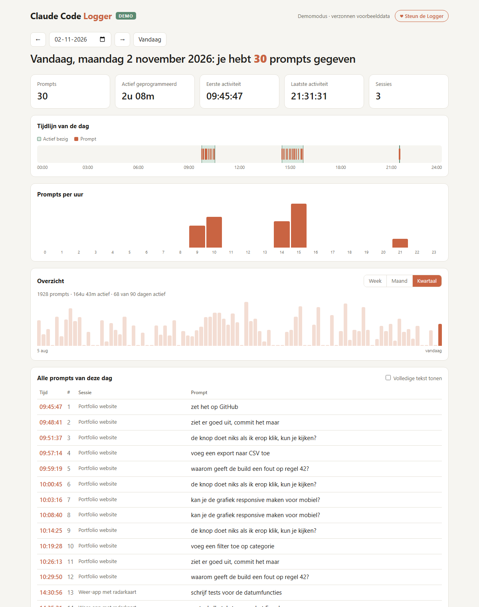

# Claude Code Logger

**Zie wanneer je programmeert met Claude Code: elke prompt tot op de seconde, je actieve tijd en je patronen per dag, week, maand en kwartaal.**

> *"Vandaag, maandag 2 november 2026: je hebt 30 prompts gegeven."*

<picture>
  <source media="(prefers-color-scheme: dark)" srcset="docs/dashboard-dark.png">
  
</picture>

<sub>Screenshot met verzonnen demodata.</sub>

Claude Code Logger is een klein lokaal dashboard voor Windows. Het leest de gesprekken die Claude Code al op je pc bewaart (`%USERPROFILE%\.claude\projects`) en laat zien wanneer je actief was. Er gaat niets naar het internet: alle data blijft op je eigen pc.

*English: a local, privacy-first dashboard that shows when you work with Claude Code — every prompt to the second, active coding time, a daily timeline and week/month/quarter overviews. Reads Claude Code's own transcripts; nothing leaves your machine.*

## Wat je ziet

- **Prompts per dag**, met de exacte tijd van elke prompt en in welke sessie je hem gaf
- **Actief geprogrammeerd**: je totale actieve tijd, plus je eerste en laatste activiteit van de dag
- **Tijdlijn van 24 uur** met je actieve periodes en een streepje per prompt
- **Prompts per uur**, zodat je ziet wanneer je het meest doet
- **Overzicht per week, maand of kwartaal**, met je totale prompts, actieve tijd en actieve dagen
- **Eigen archief**: Claude Code wist oude gesprekken na verloop van tijd, maar de logger bewaart alles wat hij ooit heeft gezien
- Ververst automatisch elke 15 seconden en heeft een licht en donker thema

## Installeren

Je hebt alleen [Node.js](https://nodejs.org) nodig, versie 18 of nieuwer. Er zijn geen extra pakketten nodig.

1. Download deze repository via **Code → Download ZIP** en pak hem uit.
2. Dubbelklik op `launch.vbs` om de app te starten zonder consolevenster. Wil je het consolevenster wel zien, gebruik dan `start.bat`.
3. Het dashboard opent op <http://localhost:4317>.

Wil je een snelkoppeling op je bureaublad? Klik met de rechtermuisknop op `launch.vbs` en kies **Snelkoppeling maken**. `claude-code-logger.ico` kun je als icoon gebruiken.

**Tip:** Claude Code bewaart gesprekken standaard 30 dagen. Wil je de logger ook oudere geschiedenis laten zien? Zet dan in `%USERPROFILE%\.claude\settings.json`:

```json
{ "cleanupPeriodDays": 365 }
```

## Demomodus

Wil je de app laten zien zonder je eigen prompts te tonen? Open dan <http://localhost:4317/?demo>. Je ziet dan 120 dagen verzonnen maar realistische data, met een **DEMO**-label in beeld. Met `?demo&range=90` opent het overzicht meteen op kwartaal. Je echte data en je archief worden in demomodus niet gelezen of aangepast.

## Hoe het werkt

- `server.js` is een kleine Node-server die alleen bereikbaar is op `127.0.0.1`. Hij leest de `.jsonl`-gesprekken van Claude Code en telt alleen berichten die je zelf hebt getypt. Systeemmeldingen, toolresultaten en commando's tellen niet mee. Prompts uit geforkte sessies tellen maar één keer.
- De **actieve tijd** bestaat uit alle momenten waarop jij of Claude iets deed. Een pauze van meer dan 10 minuten begint een nieuwe periode.
- Het **archief** staat in de map `data` naast de app-map, in `../data/archive.json`. Daarin staan ook de teksten van je prompts. Deel die map dus niet.

## Steun de Logger

Claude Code Logger is gratis. Vind je hem handig? Met een kleine donatie help je mee aan nieuwe versies met meer grafieken en patronen.

☕ **[Trakteer op een koffie](https://urbantechmonk.gumroad.com/coffee)**

---

© 2026 rpg86x. Alle rechten voorbehouden. Claude Code Logger is een onafhankelijk project en is niet verbonden aan Anthropic.
